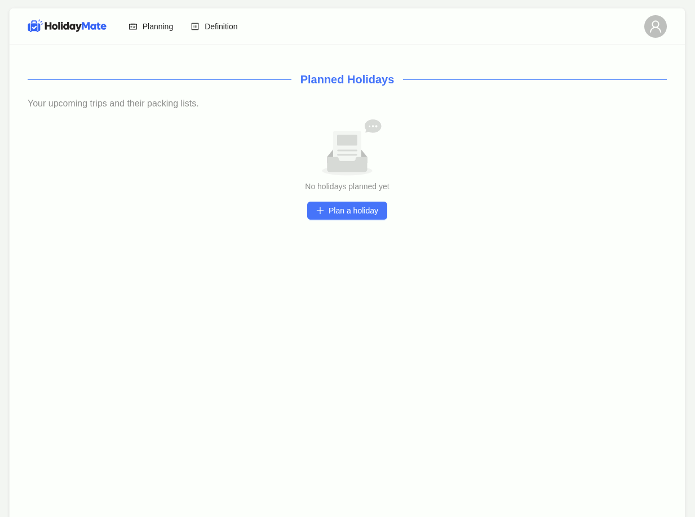

(AI Generated) 

# Welcome to **HolidayMate**  
A full-stack activity/packing-list planning application.

## What is it about

In HolidayMate you can define activites, then plan a Holiday with multiple 
activities and generate your individual packing list.  
Learn from your mistakes and come prepared in your next holiday.
Pack what you actually need instead of finding out on location!

## UI Interfaces

## Tech Stack

| Layer    | Technology                                             |
| -------- | ------------------------------------------------------ |
| Frontend | TypeScript, React, Ant Design, ESLint, Prettier        |
| Backend  | Java, Spring, Hibernate / Postgres                     |
| Weather Provider:| OpenWeatherMap                                 |

